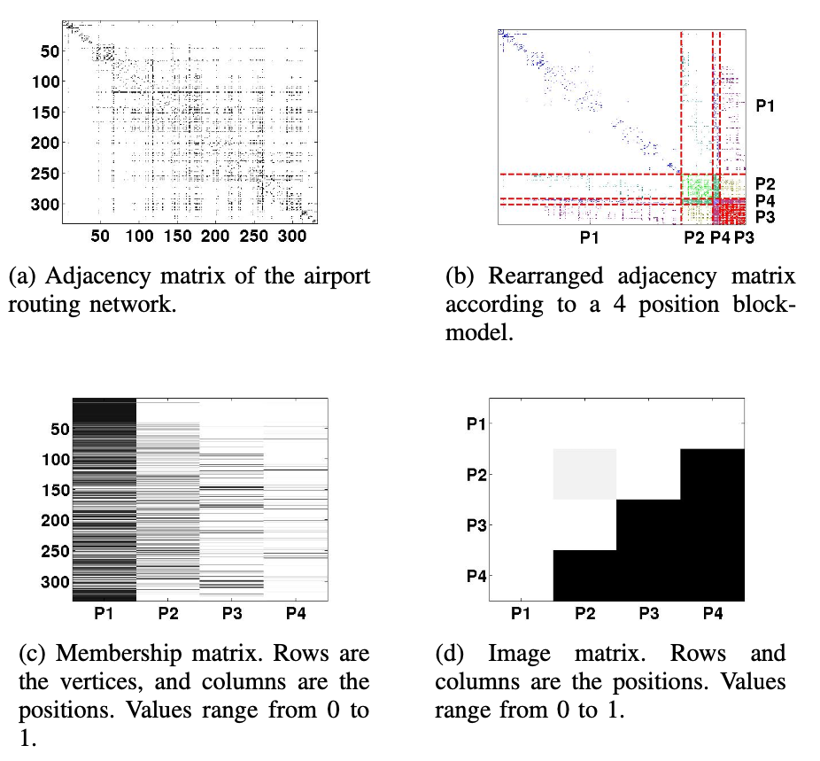

Blockmodelling summarises a graph by grouping its vertices into positions and describing how the positions connect, a compact picture of the network's structure. The standard methods alternate between two updates, one for the vertex-to-position assignment and one for the image matrix between positions.

This paper replaces the alternation with a single-step optimisation. Algebraic simplification lets the method update the lower-dimensional latent structure directly, which improves both convergence and accuracy. We then extend the approach to multi-view blockmodelling, where several graphs share the same vertices. On real datasets it reaches much higher accuracy than competing approaches at comparable running times.

<figure><figcaption>An adjacency matrix before and after rearranging by blockmodel position, with the membership and image matrices.</figcaption></figure>

This came out of my 2019 research internship at the University of Melbourne.
